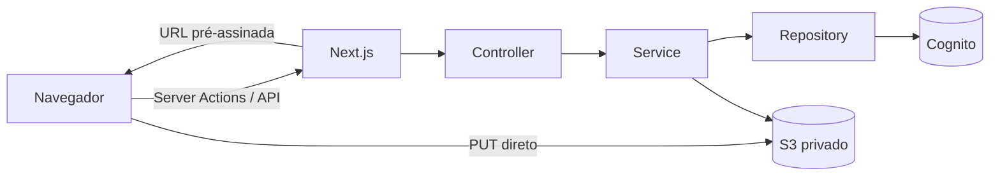

# TES — Galeria privada com AWS

Aplicação web em que cada usuário se cadastra, entra e guarda **fotos, vídeos e documentos privados**, com perfil editável. Projeto da disciplina *Tópicos em Engenharia de Software — Computação em Nuvem* (UFPI).

> **No ar:** <https://32-194-55-125.sslip.io>. A versão publicada ainda é anterior à API de perfil; veja as pendências em [docs/deploy-e-pendencias.md](docs/deploy-e-pendencias.md).

- **Autenticação:** AWS Cognito (cadastro com confirmação por e-mail, login, troca de senha).
- **Armazenamento:** bucket S3 privado; o navegador envia os arquivos direto ao S3 por URL pré-assinada.
- **Sem banco de dados próprio:** o perfil vive nos atributos do Cognito e os arquivos no S3.
- **Infraestrutura:** rede AWS (VPC, sub-rede, Security Group) em Terraform; aplicação em EC2 com nginx e HTTPS.

## Funcionalidades

| Área | O que faz |
| --- | --- |
| Conta | Cadastro (nome, username, e-mail, senha, descrição), confirmação por código, login por e-mail e senha, logout |
| Galeria | Upload direto ao S3, listagem por usuário, abas por tipo (imagem, vídeo, documento), busca, prévia em modal, exclusão |
| Perfil | Ver e editar nome e descrição, trocar foto e senha (username e e-mail são somente leitura) |
| API REST | `GET/PATCH /api/profile` e `PUT /api/profile/avatar` — ver [docs/api.md](docs/api.md) |

## Arquitetura

### Na AWS


Região `us-east-1`. A EC2 fica na sub-rede pública da VPC `tes-vpc`, com IP elástico, e recebe o HTTPS no nginx, que repassa para o Next.js. A IAM Role `ec2-app-role` dá à aplicação acesso ao Cognito e ao bucket S3 privado, sem chaves no código. Configuração completa em [docs/arquitetura.md](docs/arquitetura.md#infraestrutura).

### Na aplicação



MVC adaptado ao Next.js, em camadas. Explicação completa em [docs/arquitetura.md](docs/arquitetura.md).

## Stack

Next.js 16 (App Router) · React 19 · TypeScript · Tailwind CSS v4 · AWS SDK v3 (Cognito + S3) · Zod · Vitest · Terraform · EC2 + nginx.
Detalhes e versões em [docs/stack.md](docs/stack.md).

## Como executar

Requisitos: **Node.js 22** (ver `.nvmrc`) e npm.

```bash
git clone https://github.com/focarica/tes-aplicacao.git
cd tes-aplicacao
npm ci
cp .env.example .env.local   # preencha com os dados do Cognito e do S3
npm run dev                  # http://localhost:3000
```

Cadastro, login e galeria precisam de um User Pool do Cognito e de um bucket S3 já criados. O passo a passo completo está em [docs/como-rodar-e-testar.md](docs/como-rodar-e-testar.md).

### Scripts

| Comando | Função |
| --- | --- |
| `npm run dev` | Servidor de desenvolvimento |
| `npm run build` / `npm start` | Build de produção (modo `standalone`) e execução |
| `npm test` | Testes automatizados (Vitest, sem chamadas reais à AWS) |
| `npm run typecheck` | Checagem de tipos (`tsc --noEmit`) |
| `npm run lint` | ESLint com zero avisos permitidos |

## Estrutura do repositório

```text
src/
  app/            Páginas, layouts, Server Actions e rotas de API
  components/     Componentes de interface (auth, galeria, perfil)
  controllers/    Sessão, validação (Zod) e tradução de erros em status HTTP
  services/       Regras de negócio (perfil, foto, contrato de autenticação)
  repositories/   Acesso a dados (implementação sobre o Cognito)
  models/         Tipos e contratos
  lib/auth/       Adaptadores Cognito, sessão (cookie + JWT) e validação
  lib/aws/        Adaptador S3 (presign, listagem, exclusão)
tests/            Testes unitários e de fluxo (Vitest)
infra/            Terraform (rede) e guias de Cognito e S3
docs/             Documentação do projeto
```

## Frontend

O visual segue o projeto `gallery-TES`: Tailwind CSS v4, paleta em
`src/app/globals.css` (parchment, cream, sand, espresso e latte), cards
arredondados e layout responsivo. As telas de início, login, cadastro,
confirmação e dashboard usam o mesmo tema.

O dashboard exibe a galeria com abas por tipo, busca, estado vazio, upload e
exclusão. O envio usa URL pré-assinada e vai direto do navegador para o S3; a
listagem lê o prefixo do usuário autenticado e devolve URLs de visualização
assinadas. É preciso configurar o bucket e `S3_BUCKET` (ver `infra/README.md`).

O cabeçalho do dashboard mostra "Galeria" ou "Perfil" no canto superior esquerdo,
em Geist Mono e com animação a cada troca de rota, e a foto e o nome do usuário
no canto direito. Clicar no usuário abre um menu com "Editar perfil" e "Galeria".
O botão vermelho de sair fica no rodapé, também à direita. Cada navegação exibe
um overlay de tela cheia (montado no `body`) com fundo escuro, e as páginas e
menus entram com animação (respeitando `prefers-reduced-motion`). Imagens
aparecem de uma vez, sem desenho progressivo. O modal de prévia de mídia fica
centralizado na janela e anima na abertura e no fechamento. Em
`/dashboard/perfil` foto, dados e edição ficam no mesmo card; clicar na foto abre
o seletor de arquivo (com ícone de pincel no hover). O usuário vê nome, username,
email, foto, descrição e data de criação, edita nome e descrição e altera a
senha. Username e email são somente leitura nesta versão.

Limites de upload: 50 MB por imagem, 500 MB por vídeo e 100 MB por documento.

## Backend de perfil: o que foi feito e como foi integrado

O backend de perfil implementa as camadas previstas na organização acima, sem
banco de dados novo: o perfil continua nos atributos do Cognito e a foto no S3.

```text
Telas (Server Actions) ─┐
API /api/profile ───────┴─> controller ─> serviço ─> repositório ─> Cognito
                                             └──────────────────────> S3 (foto)
```

**O que foi feito**

- `src/repositories/cognito-user.repository.ts`: lê e grava o perfil no Cognito
  e recusa acessar o perfil de outro usuário.
- `src/services/user.service.ts`: regras do perfil e da foto (dono do arquivo,
  imagem de até 5 MB, remoção do envio quando algo falha e da foto anterior). O
  perfil devolvido não inclui a chave interna da foto.
- `src/controllers/profile.controller.ts`: exige sessão verificada, valida a
  entrada com Zod, com mensagens em português, e traduz erros em status HTTP.
- `src/app/api/profile`: API REST de perfil (ver [docs/api.md](docs/api.md)).
- 75 testes automatizados novos, sem chamadas à AWS.

## Documentação

| Documento | Conteúdo |
| --- | --- |
| [docs/arquitetura.md](docs/arquitetura.md) | Camadas, fluxos (login, upload, perfil), segurança, infraestrutura na AWS e decisões |
| [docs/stack.md](docs/stack.md) | Tecnologias, versões e o papel de cada uma |
| [docs/como-rodar-e-testar.md](docs/como-rodar-e-testar.md) | Configuração, variáveis, execução, testes, build |
| [docs/api.md](docs/api.md) | Rotas HTTP, formatos e códigos de erro |
| [docs/deploy-e-pendencias.md](docs/deploy-e-pendencias.md) | Estado da publicação, como publicar uma nova versão, pendências, limitações e problemas conhecidos |
| [infra/README.md](infra/README.md) | Terraform da rede, Security Group, IAM e S3 |
| [infra/cognito/README.md](infra/cognito/README.md) | Configuração do User Pool e App Client |

## Convenções

- Código e mensagens ao usuário em português; commits no padrão *Conventional Commits* (`feat:`, `fix:`, `docs:`, `refactor:`).
- Segredos ficam só no servidor (`.env.local`, nunca com prefixo `NEXT_PUBLIC_`) e não vão para o Git.
- Este projeto usa uma versão do Next.js com mudanças incompatíveis; consulte `AGENTS.md` e `node_modules/next/dist/docs/` antes de alterar convenções do framework.
