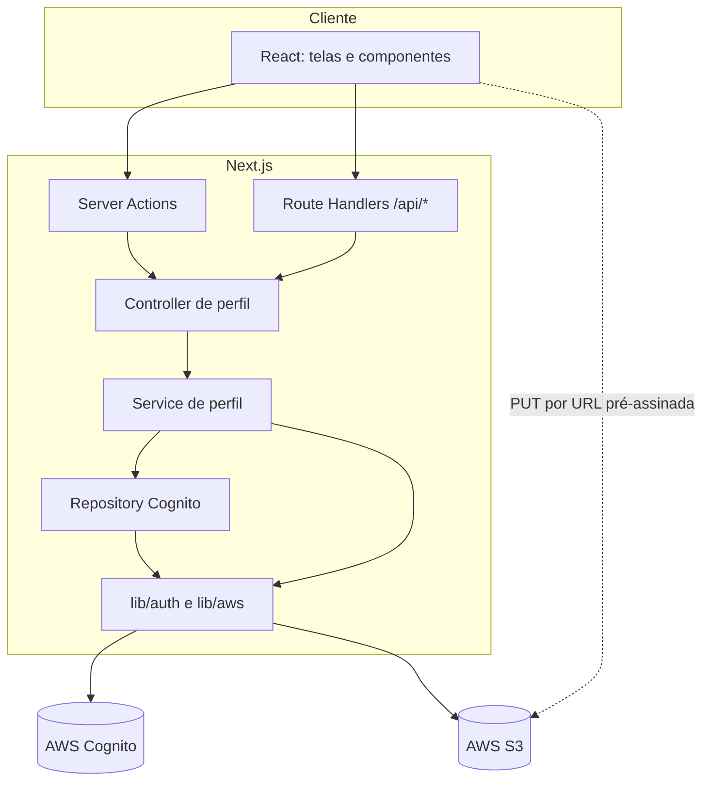
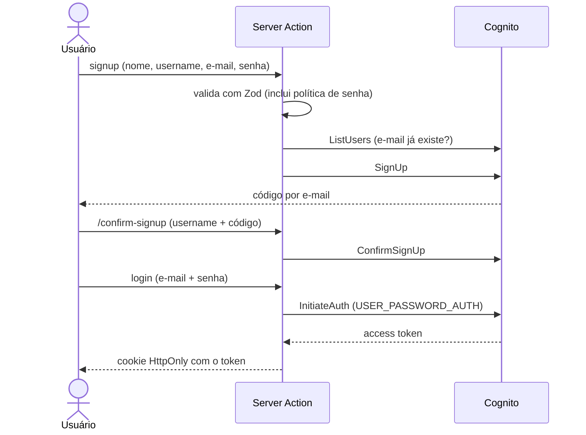
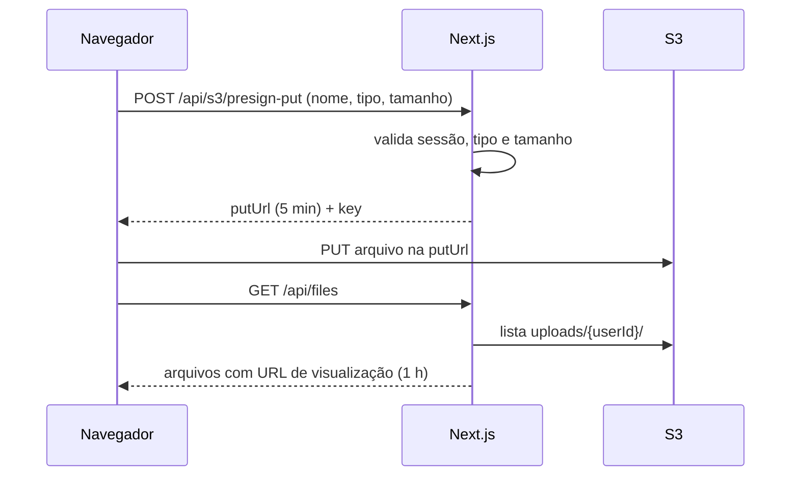

# Arquitetura

## Visão geral

O TES é uma aplicação **Next.js full-stack**: o mesmo projeto serve as telas (React) e executa o backend (Server Actions e Route Handlers). Não há banco de dados nem serviço separado. Duas peças da AWS guardam o estado:

| Dado | Onde fica |
| --- | --- |
| Contas, senha, nome, descrição, chave da foto | **Cognito** (atributos do User Pool) |
| Fotos, vídeos e documentos | **S3** (bucket privado) |



## Camadas (MVC adaptado)

| Camada | Pasta | Responsabilidade |
| --- | --- | --- |
| View | `src/app`, `src/components` | Páginas, layouts e componentes. Sem regra de negócio. |
| Entrada | `src/app/actions`, `src/app/api` | Recebem a requisição e delegam. Server Actions servem as telas; Route Handlers servem a API REST. |
| Controller | `src/controllers` | Exige sessão verificada, valida a entrada com Zod e converte erros em `{ ok, status, error }`. |
| Service | `src/services` | Regras do perfil e da foto (dono do arquivo, limite de 5 MB, limpeza em caso de falha). Independente de HTTP. |
| Repository | `src/repositories` | Contrato `UserRepository` e implementação sobre o Cognito. Trocar o armazenamento exige apenas outra implementação. |
| Adaptadores | `src/lib/auth`, `src/lib/aws` | Clientes do Cognito e do S3, sessão, JWT e validação de mídia. |
| Models | `src/models` | Tipos e contratos compartilhados. |

Fluxo do perfil, que usa todas as camadas:

```text
Tela (Server Action) ─┐
API /api/profile ─────┴─> controller ─> service ─> repository ─> Cognito
                                           └────────────────────> S3 (foto)
```

Cadastro, login, logout e troca de senha ainda chamam os adaptadores de `src/lib/auth` diretamente a partir das Server Actions, sem controller. A galeria também usa `src/lib/aws/s3.ts` direto nas rotas `/api/files` e `/api/s3/presign-put`.

## Fluxos principais

### Cadastro e login



### Sessão e autorização

- O **access token** do Cognito fica em um cookie `HttpOnly`, `SameSite=Lax` e `Secure` em produção, com a duração do token.
- A cada requisição protegida, o servidor verifica o JWT com `aws-jwt-verify` (emissor, expiração, User Pool, App Client e finalidade).
- A identidade do usuário é o `sub` do token. Todo acesso a dados confere se o recurso pertence a esse `sub`.
- Não há renovação automática: ao expirar, o usuário entra de novo.
- O layout do dashboard redireciona para `/login` quando não há sessão válida.

### Upload na galeria (direto ao S3)



O arquivo nunca passa pelo servidor Next.js, o que dispensa limite de corpo de requisição e reduz a carga.

### Foto de perfil

1. `POST /api/s3/presign-put` com `scope: "avatar"` devolve `putUrl` e `key` em `avatars/{userId}/`.
2. O navegador envia a imagem ao S3.
3. `PUT /api/profile/avatar` com `{ key }`: o service confere o dono, o tipo e o limite de 5 MB, grava a chave em `custom:avatar_key` e apaga a foto anterior. Se algo falha, o arquivo enviado é removido.

## Layout dos dados no S3

```text
uploads/{userId}/{uuid}__{nome-sanitizado}   galeria
avatars/{userId}/...                          foto de perfil
```

O prefixo do usuário é verificado no servidor antes de assinar URLs ou excluir. Não há banco de metadados: a listagem lê o próprio S3.

| Limite | Valor |
| --- | --- |
| Imagem | 50 MB |
| Vídeo | 500 MB |
| Documento | 100 MB (PDF, ZIP, TXT, DOC, DOCX) |
| Foto de perfil | 5 MB (JPEG, PNG, WebP, GIF) |

## Segurança

| Medida | Onde |
| --- | --- |
| Cookie HttpOnly, SameSite=Lax, Secure em produção | `src/lib/auth/session.ts` |
| JWT verificado no servidor; identidade = `sub` | `session.ts`, `authorization.ts` |
| Segredos só no servidor (sem `NEXT_PUBLIC_`) | `.env.example`, módulos com `server-only` |
| Bucket privado; acesso só por URL pré-assinada curta | `src/lib/aws/s3.ts` |
| Prefixo por usuário e bloqueio de `..` nas chaves | `assertPrefix` em `s3.ts` |
| Validação de entrada com Zod (mensagens em português) | `validation.ts`, `profile.controller.ts` |
| Política de senha replicada no cliente da aplicação | `cognitoPasswordSchema` |
| Credenciais AWS pela cadeia padrão do SDK (IAM Role na EC2); nenhuma chave no código | `src/lib/auth/client.ts` |
| Server Actions com verificação de origem padrão do Next.js | Next.js |

## Infraestrutura


| Peça | Configuração em produção |
| --- | --- |
| Região | `us-east-1` (Norte da Virgínia) |
| VPC e sub-rede | `tes-vpc` (10.0.0.0/16) e sub-rede pública `tes-subnet-public` (10.0.1.0/24) |
| Rotas | Tabela da sub-rede pública: `0.0.0.0/0` para o Internet Gateway |
| Security Group | `tes-sg-web`: portas 80 e 443; SSH opcional |
| EC2 | nginx na porta 443 repassa para o Next.js; IP elástico 32.194.55.125 |
| IAM | Role `ec2-app-role`, com as permissões da EC2 para o Cognito e o S3 |
| Cognito | User Pool com os usuários e o perfil |
| S3 | Bucket privado `tes-app-es2` |
| Custos | AWS Budgets com alerta de US$ 20 |
| Endereço | <https://32-194-55-125.sslip.io> |

O Terraform (`infra/terraform`) cria somente a **rede**: VPC, sub-rede pública, Internet Gateway, tabela de rotas e Security Group (portas 80 e 443; SSH opcional). EC2, IAM, Cognito e S3 são criados manualmente. Detalhes em [infra/README.md](../infra/README.md).

## Decisões de projeto

| Decisão | Motivo |
| --- | --- |
| Sem banco de dados | O Cognito já guarda o perfil e o S3 lista os arquivos; menos custo e menos peças para operar. |
| Upload direto ao S3 | Evita trafegar arquivos grandes pelo servidor. |
| Controller, service e repository no perfil | Isola regras de negócio de HTTP e de Cognito, e facilita testar sem AWS. |
| Next.js em modo `standalone` | Gera um servidor Node enxuto, simples de implantar na EC2 atrás de um proxy. |
| Estado do Terraform local | Suficiente para uma pessoa aplicar a rede; para equipe, usar backend remoto. |

## Limitações conhecidas

Sem renovação de sessão, sem MFA (desafios adicionais bloqueiam o login), sem recuperação de senha e sem alteração de username ou e-mail. A data de criação do perfil depende da permissão IAM `cognito-idp:AdminGetUser`. Lista completa em [deploy-e-pendencias.md](deploy-e-pendencias.md).
